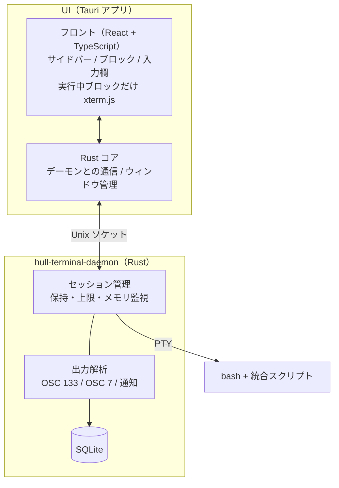

# hull-terminal 要件定義
 
Sep 25, 2026 · @Coxless
 
## 概要
 
hull-terminal は、コマンドと出力を1往復ずつブロックとして扱うチャット履歴型のターミナルです。目的は、自分が毎日楽しく使えるものを作ることで、完成したら公開もします。
 
- 入力欄を画面の下に固定し、コマンドと出力はブロックとして上に積み上げる
- サイドバーで過去のセッションを一覧し、いつでも再開できる
- ピン留めして「プロセスを保持」をオンにしたセッションは、ウィンドウを閉じても裏で動き続ける
- Claude Code や vim などの対話型アプリも、ブロックの中でそのまま使える
画面のモック：[チャット履歴型ターミナル](https://claude.ai/artifact/TJxQnoyKuTZ9c6PasUCBYr)
 
参考にした既存ツール：Warp（ブロック表示と下固定の入力欄）、Wave Terminal の旧版（ブロック・セッション・履歴。v0.8 で作り直され廃止）。どちらにも「過去のセッションを一覧して再開する」機能はありません。
 
## 対象範囲
 
対象は Ubuntu の bash だけです。Windows（Git Bash）にも対応する計画でしたが、Oct 12, 2026 にやめました。
 
| 項目 | 対象 | 対象外 |
| --- | --- | --- |
| OS | Ubuntu | Windows、macOS |
| シェル | bash | zsh、fish |
| ウィンドウ | 1ウィンドウに1セッション。切り替えはサイドバーで行う | タブ、画面分割 |
| 互換性 | 自分の使い方で困らないこと | 既存ターミナルとの設定や操作の互換 |
| 連携 | なし | ブラウザ・Slack 連携（検討のうえ外した） |
 
## 画面と機能要件
 
画面は「サイドバー」「ブロック一覧」「下固定の入力欄」の3つで構成します。
 
**サイドバー**
 
- セッションを「ピン留め／今日／昨日／今週」に分けて表示する
- 各セッションに状態（実行中／休止中／終了）、メモリ使用量、保持マーク、入力待ちバッジを表示する
- セッション名と、過去に実行したコマンドで検索できる
- 下部にプロセス保持の数と上限、裏で動いているセッションの合計メモリを表示する
**ブロック**
 
- コマンド1回とその出力を1ブロックとし、終了コード・実行時間・時刻を表示する
- コピー、再実行、長い出力の折りたたみができる
- 「失敗のみ」で失敗したブロックだけに絞り込める
- 実行中のブロックは本物のターミナルとして動き、キー入力はすべてそのブロックに届ける（Shift+Enter や Esc も変換せず渡す）
- 終了したブロックは表示を固定し、色付きで保存する
- vim など全画面アプリのブロックは、終了後に「全画面で実行しました」とだけ表示する
**入力欄**
 
- 今のディレクトリ、シェル、git ブランチを上に表示する
- Enter で実行、Shift+Enter で改行。日本語の変換を確定する Enter では実行しない
- ↑ で履歴。Tab の補完は、履歴とファイル名を自前で補完する案で仮置きする（未決事項を参照）
- ブロックが入力を受けている間は「ブロックに入力中」の表示に切り替える
- 終了したセッションで入力して Enter を押すと、そのまま再開する
**Claude Code 対応**
 
- Claude Code が入力や許可を待っているとき、サイドバーに「入力待ち」を表示する（ベルや通知の制御シーケンス、フックで検知）
- 最後に Claude Code を使っていた終了済みセッションを再開するとき、`claude --continue` の実行を提案する
## セッションのライフサイクル
 
セッションの状態は「実行中」「休止中」「終了」の3つです。休止中になれるのは、ピン留めして「プロセスを保持」をオンにしたセッションだけです（方式B）。
 
| 状態 | 意味 | 再開したとき |
| --- | --- | --- |
| 実行中 | ウィンドウに表示中 | そのまま |
| 休止中 | 表示していないが、デーモンの下でプロセスが生きている | 完全に元どおり（再接続） |
| 終了 | プロセスはもうない | 記録からディレクトリ・環境変数・関数・エイリアスを戻し、新しい bash で起動 |
 
**ルール**
 
1. ピン留めとプロセス保持は別の設定。保持はピン留めしたセッションでだけオンにでき、ピン留めした直後はオフ
2. 保持できるセッション数には上限がある（初期値 5、設定で変更可）。上限に達したら、各セッションのメモリと動作中のコマンドを並べて、どれの保持をやめるか選ばせる。自動では外さない
3. 保持オフのセッションから離れるとき、状態を保存して終了する。何かが動いていれば「キャンセル／終了して移動／ピン留めして保持」の確認を出す
4. 休止中のセッションの保持をオフにしたら、状態を保存して終了する
5. 終了したセッションの保持をオンにした場合は、次に再開したときから保持が効く
6. 保持オフのセッションも、離れてから数分間は休止中として残す（うっかり対策の猶予時間）
7. PC を再起動すると全セッションが終了になる。オプションで、アプリ起動時に保持オンのセッションを自動で再開できる
「再開」はプロセスの中身まで戻すものではありません。動いていたサーバー、アプリ内の状態、SSH などの接続は、終了すると失われます。
 
## アーキテクチャ
 
画面（Tauri アプリ）と、PTY を持つ管理デーモンを別プロセスに分けます。tmux のクライアントとサーバーの関係と同じで、ウィンドウを閉じたり UI が落ちたりしても bash は生き続けます。
 

 
**デーモンの起動**：アプリを開いたときにデーモンがいなければ起動します。ログイン時の自動起動はしません。休止中のセッションがなくなれば、デーモンも終了します。
 
**ブロックの区切り**：bash を `--rcfile` で起動し、`~/.bashrc` を読んだ後に統合スクリプトを読み込みます。スクリプトは `PS0` と `PROMPT_COMMAND` で次の合図を出します。
 
- OSC 133 A：プロンプト開始。B：コマンド入力開始。C：コマンド実行開始。D：終了と終了コード
- OSC 7：今のディレクトリ
- プロンプト表示のたびに、ディレクトリと環境変数をデーモンに送る（終了からの復元用）
**入力の流れ**
 
1. 入力欄で Enter → UI がテキストをデーモン経由で PTY に送る
2. bash が出すプロンプトとコマンドの表示は、デーモンが A〜C の合図をもとに取り除く。ブロックの見出しには入力欄の内容を使う
3. C から D までの出力がそのブロックの中身になる。実行中は xterm.js に流し、キー入力は xterm.js から PTY に直接送る
4. D を受け取ったらブロックを確定し、色付きの静的な HTML 表示に切り替える
**表示の軽さ**：xterm.js で表示するのは実行中の1ブロックだけです。終わったブロックは、保存した出力を色付きの HTML に変換して表示します。ブロックが数百個あっても重くならないようにするためです。
 
## 技術選定
 
UI は Tauri v2 + React、デーモンは Rust で作ります。言語は TypeScript と Rust の2つに絞ります。
 
| 層 | 採用 | 理由 |
| --- | --- | --- |
| アプリの外枠 | Tauri v2 | 見た目を Web 技術で自由に作れ、Electron より軽い。Rust と直接つながる |
| フロント | React + TypeScript + Vite | 書き慣れている |
| 状態管理 | Zustand | 小さくて、大量の出力更新でも必要な部分だけ再描画できる |
| 実行中ブロックの表示 | xterm.js（@xterm/xterm、WebGL アドオン） | VS Code でも使われる成熟したターミナル。Claude Code や vim が動く |
| 終了ブロックの表示 | @xterm/headless + @xterm/addon-serialize | カーソル移動や上書きを正しく反映した色付き HTML を作れる |
| デーモンの基盤 | Rust + tokio | 多数の PTY と接続を非同期で扱う |
| PTY | portable-pty | WezTerm 由来。PTY の扱いを任せられる |
| 制御シーケンス解析 | vte（crate） | Alacritty 由来のパーサ。OSC 133 / 7 / 9 を拾うのに使う |
| UI とデーモンの通信 | interprocess（Unix ソケット）+ 長さ付きフレームの MessagePack | 出力はバイナリのまま流せる |
| 保存 | SQLite（rusqlite、bundled）+ zstd 圧縮 | 1ファイルで扱いやすく、履歴検索も SQL でできる |
| メモリ監視 | sysinfo | プロセスツリーごとのメモリを取れる |
| 設定 | YAML（後から Lua を mlua で追加） | 設定の章を参照 |
| 配布 | Tauri のバンドラー（.deb / AppImage）+ GitHub Releases | 公開時にそのまま使える |
| CI | GitHub Actions（Ubuntu でビルドとテスト） | プルリクエストごとに壊れに気づける |
 
Ubuntu では Tauri の画面が WebKitGTK で動きます。日本語入力や描画で致命的な問題が出た場合は、画面層だけ Electron に移す逃げ道を残します。デーモンが分かれているので、移すのはフロントと通信部分だけで済みます。
 
## データ保存
 
すべて SQLite の1ファイルに保存し、書き込むのはデーモンだけです。出力は受け取ったらすぐ書き、メモリには直近の数千行だけを残します。
 
| テーブル | 主な項目 |
| --- | --- |
| sessions | id、タイトル、シェル、開始・終了時刻、状態、ピン留め、プロセス保持 |
| blocks | id、セッション、コマンド、ディレクトリ、開始・終了時刻、終了コード、全画面アプリかどうか |
| output\_chunks | ブロック、連番、出力の生バイト（zstd 圧縮、制御シーケンス込み） |
| snapshots | セッション、時刻、ディレクトリ、環境変数、関数、エイリアス |
| blocks\_fts | コマンドと出力の全文検索用の索引（FTS5） |
 
**状態の保存タイミング**
 
- プロンプトが表示されるたびに、ディレクトリと環境変数だけを保存する（軽く、PC が突然落ちても残る）
- bash が正常に終わるとき（`trap EXIT`）に、関数とエイリアスまで含めて保存する
**出力の保存量**
 
- 1ブロックにつき最大 10MB。超えた分は先頭と末尾を残して間を省き、「省略した」と記録する
- 全体で 2GB を超えたら、古いセッションの出力から消す。ピン留めしたセッションは消さない
- 出力を消しても、コマンドや終了コードなどの記録は残す
保存場所：`~/.local/share/hull-terminal/` を想定しています。
 
## 設定
 
MVP は YAML の設定ファイル1つで始め、後から Lua で動きを拡張できるようにします。テーマや上限のような「値」は YAML、イベントでの処理のような「動き」は Lua という分担です。
 
```yaml
# ~/.config/hull-terminal/config.yaml
session:
  keep_limit: 5            # プロセス保持の上限
  grace_minutes: 5         # 保持オフでも残す猶予
  restore_on_launch: true  # 起動時に保持オンのセッションを再開
storage:
  block_max_mb: 10
  total_max_gb: 2
appearance:
  theme: ember
  font: { mono: "JetBrains Mono", ja: "BIZ UDGothic", size: 14 }
keys:
  new_session: "Ctrl+T"
  search: "Ctrl+K"
```
 
Lua でできるようにしたいことの例：ブロックが失敗したら通知を出す、特定のディレクトリでは自動でピン留めする、セッション名を自分のルールで付ける。Lua はデーモン側（mlua）で動かします。
 
YAML の Rust 向けライブラリは、定番だった serde\_yaml の保守が終わっているので、実装前に後継を選びます。
 
## MVP とロードマップ
 
MVP のゴールは「Ubuntu で毎日の作業と Claude Code が hull-terminal だけで済むこと」です。デーモンと画面の分離は最初から入れます。
 
| Phase | 内容 | 完了の目安 |
| --- | --- | --- |
| 1. 土台 | デーモンが bash を1つ起動し、UI から接続して xterm.js 1つで操作できる | 普通のターミナルとして使える |
| 2. ブロック | 統合スクリプト、OSC 133 で区切る、入力欄、終了ブロックの固定表示 | コマンドごとにカードが積み上がる |
| 3. 保存と履歴 | SQLite 保存、サイドバー、終了セッションの再開、検索 | 昨日のセッションを開いて続きが打てる |
| 4. 休止中 | ピン留め、プロセス保持、上限、確認ダイアログ、メモリ表示 | ウィンドウを閉じても npm run dev が生きている |
| 5. Claude Code | 入力待ちバッジ、キーの素通しの確認、`claude --continue` の提案 | Claude Code で一日作業できる |
| 6. 公開 | 設定ファイル、インストーラー、README、GitHub Releases | 他の人が入れて使える |
 
MVP の後に検討するもの：Lua による拡張、演出（アニメーションやテーマ）、ブロックのピン留めと共有、bash に問い合わせる補完。
 
## 未決事項とリスク
 
**未決事項**
 
- [ ] Tab 補完の方式：履歴とファイル名を自前で補完する案で仮置き中。bash に問い合わせるか、MVP では補完なしにするか
- [x] 正式名称：hull-terminal に決定
- [ ] キー操作の切り替え：実行中ブロックと入力欄の間で、どのキーでフォーカスを移すか
- [x] 公開時のライセンス：MIT に決定
- [ ] YAML ライブラリの選定
**リスクと対策**
 
| リスク | 対策 |
| --- | --- |
| プロンプトやコマンド表示の取り除きが崩れ、ブロックに余計な文字が混ざる | Phase 2 で最優先に検証する。崩れたときに生の出力を見られるデバッグ表示を用意する |
| Claude Code など全画面でない TUI が、ブロックの幅や高さの変化で表示が乱れる | 実行中ブロックには画面いっぱいの高さを与え、サイズ変更を PTY に正しく伝える |
| WebKitGTK（Ubuntu）での日本語入力や描画の不具合 | Phase 1 で早めに確認。だめなら画面層を Electron に移す |
| デーモンが落ちると全セッションが止まる | 出力と状態は常に SQLite に書き、落ちても「終了」から再開できるようにする |
