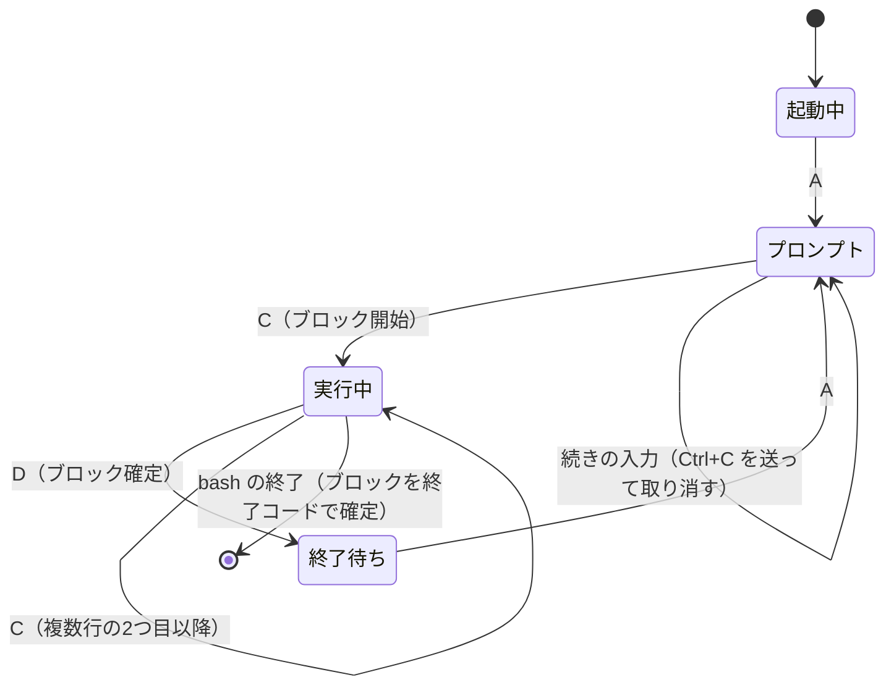

# hull-terminal Phase 2 実行計画

Oct 12, 2026 · @Coxless

## 概要

Phase 2 のゴールは、入力欄でコマンドを実行するたびに、コマンドと出力が1枚のブロックとして上に積み上がる状態にすることです。実行中のブロックは本物のターミナルとして動き、終わったブロックは色付きの静的な表示に固定します。

Phase 1 との違いは、デーモンが bash の出力を読んで「どこからどこまでが1つのコマンドの出力か」を区切ることです。区切りが崩れるとブロックに余計な文字が混ざるので、画面を作る前に、デーモンだけで区切りを確かめられるところまで先に進めます。

版は v0.2.0 とします。

## 範囲

Phase 2 では、1つのセッションの中でブロックを積み上げるところまでを作ります。ブロックの記録はデーモンのメモリに持ち、ディスクへの保存は Phase 3 に回します。

| 区分 | 内容 |
| --- | --- |
| やる | 統合スクリプトで bash に合図（OSC 133 / OSC 7）を出させる |
| やる | デーモンが合図で出力を区切り、プロンプトとコマンドの表示を取り除く |
| やる | 下固定の入力欄（Enter で実行、Shift+Enter で改行、日本語の確定、↑ の履歴、ファイル名の Tab 補完） |
| やる | ブロックの表示（終了コード・実行時間・時刻、コピー、再実行、折りたたみ、「失敗のみ」） |
| やる | 終了ブロックの静的な HTML 表示と、全画面アプリの「全画面で実行しました」 |
| やる | 開き直したときにブロックの一覧を戻す（デーモンのメモリから） |
| やる | 区切りを通さない「生の表示」（Phase 1 の画面をそのまま残す） |
| やらない | SQLite 保存、サイドバー、複数セッション、検索、終了セッションの再開 |
| やらない | ピン留め、プロセス保持、メモリ表示 |
| やらない | Claude Code の入力待ち検知、`claude --continue` の提案 |
| やらない | 設定ファイル、テーマ、キーの割り当ての変更 |
| やらない | コマンド名や引数の補完、bash に問い合わせる補完 |

## 構成

足すのは、デーモンの「統合スクリプト」「出力解析」「ブロック管理」と、フロントの「ブロック一覧」「入力欄」です。

```
crates/
├─ protocol/src/message.rs      メッセージを足し、バージョンを 2 にする
└─ daemon/src/
   ├─ integration.bash          統合スクリプト（デーモンに埋め込む）
   ├─ marker.rs                 合図の解析（vte）と区切りの状態
   ├─ block.rs                  ブロックの記録と出力の保持
   └─ session.rs                読み取った出力を marker → block に通す
app/src/
├─ store.ts                     ブロックと入力欄の状態（Zustand）
├─ BlockList.tsx / Block.tsx    ブロックの一覧と1枚の表示
├─ RunningBlock.tsx             実行中ブロック（xterm.js を載せる）
├─ InputBox.tsx                 入力欄
├─ render.ts                    出力を色付き HTML に変換する
└─ TerminalView.tsx             生の表示として残す
```

見た目は、要件定義にある画面のモックに合わせます。サイドバーの場所は Phase 3 まで空けておきません（ブロック一覧が幅いっぱいを使います）。

### 統合スクリプト

デーモンはスクリプトを自分の中に埋め込んでおき、起動時に `$XDG_RUNTIME_DIR/hull-terminal/` に書き出して、`bash --rcfile <スクリプト> -i` で起動します。配布パッケージに入れるファイルは増えません。

スクリプトがすることは次のとおりです。

1. `~/.bashrc` を読む（`--rcfile` を付けると bash は読まなくなるため。`/etc/bash.bashrc` は、Ubuntu の bash が `--rcfile` を付けても自分で読むので、スクリプトでは読まない）
2. `PROMPT_COMMAND` の先頭に自分の関数を足す。関数は直前の終了コードを D として出し、同じ終了コードを返す（ユーザーの `PROMPT_COMMAND` や `PS1` が `$?` を見ても変わらない）。`PROMPT_COMMAND` が文字列でも配列でも動くようにする
3. `PS1` の前後に A と B、`PS2` の前に「続きの入力」の合図、`PS0` に C を入れる
4. プロンプトのたびに、OSC 7 で今のディレクトリを、独自の OSC で git ブランチを出す
5. 括弧付き貼り付けを有効にする（`~/.inputrc` で切ってあっても、入力欄からの送信が崩れないように）

合図には、起動ごとに変わる合言葉を付けます。合言葉は環境変数で渡し、スクリプトがシェル変数に移してから環境変数を消します。`cat` したファイルに OSC 133 が入っていても、合言葉が合わないのでブロックは区切られません。

### 区切りの状態

デーモンは、PTY から読んだバイト列を合図の位置で切り、次の3つに分けます。合図が読み取りの境目で分かれて届いても、同じ位置で切ります。

| 区間 | 中身 | 扱い |
| --- | --- | --- |
| A → C | プロンプトと、bash が表示し直すコマンド | 捨てる（生の表示では見える） |
| C → D | コマンドの出力 | 実行中のブロックの出力にする |
| D → A、最初の A より前 | `.bashrc` の出力など | 見出しのない「ブロック外の出力」として表示する |



C → D の間に代替画面への切り替え（`CSI ? 1049 h` など）があったブロックは、全画面アプリとして記録します。

### 入力の流れ

1. 入力欄で Enter → UI が `Run` でテキストを送る。デーモンは「プロンプト」の状態のときだけ受け付ける
2. デーモンはテキストを括弧付き貼り付け（`ESC [200~` … `ESC [201~`）で包み、最後に CR を付けて PTY に書く。複数行でも1回の入力として bash に渡る。テキストに貼り付けの終わりの印が入っていたら取り除く
3. C が来たら、送ったテキストを見出しにしてブロックを開始する。C が来ないまま次の A が来たら（空行やコメントだけの行）、ブロックは作らない
4. 実行中のキー入力は、xterm.js から `Input` でそのまま PTY に送る（Phase 1 と同じ経路）
5. D が来たらブロックを確定し、入力欄にフォーカスを戻す

### 通信メッセージ

プロトコルのバージョンを 2 に上げます（`Output` の意味が「実行中ブロックの出力」に変わるため）。v0.1 のデーモンが残っていると、Phase 1 で作ったバージョン違いの誤りが表示されます。

| 方向 | メッセージ | 中身 |
| --- | --- | --- |
| UI → デーモン | Attach | 列数・行数に、生の表示かどうかを足す |
| UI → デーモン | Run | 入力欄のテキスト |
| UI → デーモン | FetchOutput | 出力を取りたい終了ブロックの番号 |
| UI → デーモン | Complete | 入力欄のテキストとカーソルの位置 |
| デーモン → UI | History | Attach への応答。ブロックの一覧（出力は含めない）、実行中のブロック、今のプロンプトの情報 |
| デーモン → UI | Prompt | 入力を受け付けられる。ディレクトリと git ブランチ |
| デーモン → UI | BlockStarted | 番号、コマンド、ディレクトリ、開始時刻 |
| デーモン → UI | Output | 実行中ブロックの出力（生の表示では、Phase 1 と同じくすべての出力） |
| デーモン → UI | BlockFinished | 番号、終了コード、終了時刻、全画面アプリかどうか |
| デーモン → UI | BlockOutput | FetchOutput への応答。出力のバイト列と、先頭を省いたかどうか |
| デーモン → UI | RunRejected | 実行しなかった理由（入力が途中、実行中で受け付けられない）と、送られてきたテキスト |
| デーモン → UI | Completions | 補完の候補 |

Hello / Input / Resize / Detach / Replay / Exited / Error は変えません。Welcome には、bash が統合スクリプトを読み込んでいるかどうかを足します。Replay は、生の表示の流し直しと、実行中ブロックのここまでの出力の流し直しに使います。

「ブロック外の出力」は、専用のメッセージを設けず、コマンドのないブロックとして BlockStarted → Output → BlockFinished を続けて送ります。画面に見える文字がないとき（改行やモードの切り替えだけのとき）は送りません。入力欄を通さずに実行されたコマンド（生の表示で打ったもの）は、コマンドが空のブロックになります。

Tauri の Rust コアは、出力のバイト列だけを今までどおり Channel でそのまま渡し、ほかの知らせは JSON で渡します。描き終えた量を知らせる仕組み（ack）は出力にだけ使います。Replay は、`replay` という知らせの次のバイト列として渡します（ブロックの表示では、実行中のブロックがないと Replay が来ないため）。

### 出力の保持

Phase 3 で SQLite に置き換えるまでの、仮の持ち方です。

| 対象 | 持ち方 |
| --- | --- |
| 実行中のブロック | Phase 1 のリングバッファ（1MB、あふれた部分のモードを復元）をブロックごとに作る |
| 終了したブロック | 確定した時点のリングの中身（最後の 1MB まで）。全ブロックの合計が 32MB を超えたら、古いブロックの出力から捨てる。コマンドや終了コードは残す |
| 生の表示用 | Phase 1 と同じ、全体で 1MB のリング |

bash が終了するとデーモンも終了するので（Phase 1 と同じ）、ブロックの記録もそこで消えます。開いているウィンドウには、閉じるまで残ります。

### 画面

**xterm.js は1つだけ作って使い回す**：コマンドのたびに作ると WebGL のコンテキストを作り直すことになるので、1つを実行中ブロックの場所に載せ替え、ブロックが始まるたびにリセットします。プロンプト待ちの間は隠しておき、列数と行数の計算にだけ使います。

**実行中ブロックの大きさ**：PTY の列数と行数は、ブロック一覧の表示領域いっぱいの大きさで固定します。表示する高さは、出力が届いた行までに切り詰め、領域いっぱいになるか代替画面に入ったら全体を見せます。`ls` のような短いコマンドで画面が大きく跳ねず、Claude Code から見た端末の大きさは変わりません。

**すぐ終わるコマンド**：開始から 80ms は xterm.js を見せず、その間に終われば最初から静的な表示にします。

**終了ブロックの表示**：xterm.js が解釈し終えたバッファを、自前の変換（`render.ts`）で1行ずつの色付き HTML にします。確定した直後のブロックは、載っていた xterm.js の内容をそのまま変換します。開き直して戻したブロックは、画面に入ったときに FetchOutput で出力を取り、画面に出さない xterm.js（`open` を呼ばない @xterm/xterm）に通して変換します。幅は実行したときの列数のままで、狭いウィンドウでは横にスクロールします。

当初は @xterm/headless と @xterm/addon-serialize を使う計画でしたが、作業6で自前の変換に変えました。行ごとの HTML がそのまま折りたたみに使え、色をテーマの CSS 変数で指せて、アドオンの内部の作りに頼らずに済むためです。@xterm/headless は、変換の単体テストでだけ使います。

**折りたたみ**：長い出力は最後の 30 行だけを表示し、「すべて表示」で広げます。変換するのは 10,000 行までです。

**フォーカス**：実行中はブロックに、それ以外は入力欄に、自動で移します。切り替えるキーは設けません（下の「決めること」を参照）。

## 作業計画

作業は 10 個です。1つの作業を1つのプルリクエストにし、完了条件を満たしてから次に進みます。1〜3 は画面なしで、`hull-ctl` と結合テストで確かめます。

| # | 作業 | 内容 | 完了条件 |
| --- | --- | --- | --- |
| 1 | 統合スクリプト | スクリプトを書き、デーモンが書き出して `--rcfile` で起動する。合言葉を渡す | 結合テストで、合図が A → B → C → D の順に届き、D に終了コードが入る。ユーザーの `PROMPT_COMMAND` と `$?` が保たれる。Phase 1 の結合テストがそのまま通る |
| 2 | 出力解析 | vte で合図を拾い、区切りの状態を進める。入出力のない純粋な部品にする | 単体テストで、1バイトずつ分かれて届いても同じ結果になる。合言葉の合わない合図を無視する。空の Enter、複数行、描き直しで状態が崩れない |
| 3 | ブロック管理と protocol v2 | セッションがブロックを記録し、クライアントごとにブロック／生のどちらかで流す。Run、History、FetchOutput を足す。`hull-ctl` をブロック単位の表示にする | 結合テストで、`echo` が1ブロックになり、出力にプロンプトとコマンドの表示が混ざらない。`false` の終了コード、複数行が1ブロック、入力が途中のときの RunRejected、`exit` でのブロックの確定、開き直しでの History を確かめる |
| 4 | Tauri の Rust コア | 新しいメッセージを中継する。`session_run`、`block_output` のコマンドを足す（`complete` は、デーモンの補完と一緒に作業9で足す） | フロントから Run を送り、BlockStarted / Output / BlockFinished が届く |
| 5 | ブロック一覧の土台 | Zustand の状態、ブロックの一覧、使い回す xterm.js、最小限の入力欄（Enter で実行するだけ） | コマンドごとにカードが積み上がり、実行中のブロックで vim と Claude Code が動く |
| 6 | 終了ブロックの固定表示 | HTML への変換、全画面アプリの表示、すぐ終わるコマンドの扱い、折りたたみ、開き直したときの遅延表示 | `ls --color` や `git log` が色付きのまま固定される。300 ブロックを戻してもスクロールが滑らか |
| 7 | 入力欄の仕上げ | Shift+Enter、日本語の確定、↑↓ の履歴（このセッションのコマンド）、ディレクトリ・シェル・git ブランチの表示、「ブロックに入力中」、入力が途中のときにテキストを戻す | 実機の ibus + Mozc で、確定の Enter で実行されない。`cd` するとディレクトリとブランチの表示が変わる |
| 8 | ブロックの操作と生の表示 | コピー（コマンド／出力）、再実行、「失敗のみ」、生の表示への切り替え（`HULL_TERMINAL_MODE=raw` とショートカット） | それぞれが動き、生の表示でプロンプトを含む出力を見られる |
| 9 | Tab 補完 | デーモンが、今のディレクトリを基準にファイル名の候補を返す。候補が1つなら確定、複数なら共通部分まで埋めて一覧を出す | 空白や日本語を含む名前、`~/`、存在しないディレクトリで正しく動く |
| 10 | 確認と公開 | フロントの単体テスト（vitest）を CI に足す。確認項目を実機で試して結果を記録する。README を更新し、v0.2.0 を公開する | 確認項目がすべて済み、`.deb` が Releases にある |

## 確認項目

次の項目がすべて済めば Phase 2 は完了です。

**ブロック**

- [ ] `echo`、`ls --color`、`git log` が、それぞれ1ブロックになり、色付きで固定される
- [ ] ブロックの出力に、プロンプトやコマンドの表示、合図の切れ端が混ざらない（色付きのプロンプト、2行のプロンプト、`PROMPT_COMMAND` を設定した `.bashrc` で確かめる）
- [ ] 終了コード・実行時間・時刻が表示され、失敗したブロックが見分けられる。「失敗のみ」で絞り込める
- [ ] 複数行のコマンドとヒアドキュメントが1ブロックになる
- [ ] 空の Enter とコメントだけの行ではブロックができない
- [ ] `cat` したファイルに OSC 133 が入っていても、ブロックが途中で切れない
- [ ] コピー、再実行、折りたたみが動く

**実行中のブロック**

- [ ] vim、less、htop が動き、終了後は「全画面で実行しました」になる
- [ ] Claude Code が崩れずに動き、Shift+Enter と Esc がそのまま届く。ウィンドウのサイズ変更に追従する
- [ ] Ctrl+C で止めたコマンドが、終了コード 130 のブロックになる
- [ ] `yes` を流している間も Ctrl+C が効き、CPU 使用率が Phase 1 の計測より悪くなっていない

**入力欄**

- [ ] Enter で実行、Shift+Enter で改行。日本語の変換を確定する Enter では実行しない
- [ ] ↑↓ で履歴をたどれる。Tab でファイル名を補完できる
- [ ] `echo "abc` のような途中の入力は実行されず、テキストが入力欄に残る
- [ ] ディレクトリと git ブランチが、`cd` や `git switch` のあとに変わる
- [ ] 統合スクリプトで、プロンプトが出るまでの時間が体感で変わらない（git ブランチの取得を含めて測る）

**セッション**

- [ ] ウィンドウを閉じて開き直すと、ブロックの一覧と実行中のブロックが戻る
- [ ] `exit` でブロックが確定し、Enter で新しい bash を起動できる
- [ ] 生の表示に切り替えると、Phase 1 と同じ画面で操作できる

**共通**

- [ ] CI の整形・clippy・テスト（Rust とフロント）と、`.deb` の検査が通る

## 事前に確かめたこと

Oct 12, 2026 に、開発機の bash 5.3.9 を PTY の下で動かし、合図の出方を確かめました。この計画の区切りの状態は、この結果に合わせてあります。CI の Ubuntu 24.04（bash 5.2）では、作業1の結合テストで確かめます。

| 入力 | 結果 |
| --- | --- |
| `echo hi` | A → B → コマンドの表示 → C → 出力 → D（終了コード 0）の順に出る |
| 空の Enter | C が出ず、D だけが出る（直前の終了コードのまま） |
| 括弧付き貼り付けで3行 + Enter | C が3回出て、D は最後に1回だけ。貼り付けの途中で、プロンプト（A と B）が描き直される |
| ヒアドキュメント（貼り付け） | C と D が1回ずつ出る |
| `echo "abc`（引用符が閉じていない） | C が出ず、`PS2` が表示される。Ctrl+C で D（終了コード 130）が出てプロンプトに戻る |
| `sleep 0.2 &` のあとに別のコマンド | `[1]+ Done` の知らせは、次のコマンドの出力のあと、D の前に出る（次のブロックに入る） |
| `exit 3` | C のあと、D が出ないまま bash が終わる |
| ユーザーの `PROMPT_COMMAND` | 自分の関数を先頭に足しても、あとの処理から見える `$?` は変わらない |

## 決めること・リスク

**着手前に決めること**

仮の答えを置いてあります。変えなければ、このまま進めます。

- [ ] Tab 補完の方式（要件定義の未決事項）：Phase 2 は、ファイル名だけをデーモンが補完する。コマンド名や引数の補完、bash に問い合わせる方式は MVP の後に検討する
- [ ] キー操作の切り替え（要件定義の未決事項）：フォーカスは状態で自動的に決め、切り替えるキーは設けない。bash が1つなので、実行中に入力欄へ移っても次のコマンドは打てない。終了ブロックをキーボードで選ぶ操作は Phase 3 以降で検討する
- [ ] 入力が途中のとき：bash に続きを入力させず、Ctrl+C で取り消して、テキストを入力欄に戻す。複数行は Shift+Enter で書く
- [ ] git ブランチの取り方：統合スクリプトがプロンプトのたびに `git` を1回呼ぶ。遅ければ、デーモンが `.git/HEAD` を読む方式に変える

**リスクと対策**

| リスク | 対策 |
| --- | --- |
| プロンプトやコマンドの表示の取り除きが崩れ、ブロックに余計な文字が混ざる | 作業 1〜3 を画面より先に済ませ、実際の bash での結合テストで固める。崩れたときは生の表示で元の出力を見る |
| Run を送ったのに C も A も来ない（`histverify` や、プロンプトで端末に問い合わせる設定など） | 入力欄に「bash の応答待ち」を出し、Ctrl+C で取り消せるようにする。生の表示で bash の状態を見られる |
| プロンプトを表示している間に出たバックグラウンドのジョブの出力は、プロンプトと区別できず、ブロックに出ない | Phase 2 では生の表示でだけ見える。既知の制限として README に書く |
| Claude Code など全画面でない TUI が、実行中ブロックの高さの切り詰めで乱れる | PTY の大きさは変えず、見せる高さだけを変える。作業5で Claude Code を最初に確かめ、だめなら実行中は常に全体を見せる |
| @xterm/headless と addon-serialize が、@xterm/xterm 6 や WebKitGTK で動かない | 作業6で、どちらも画面では使わないことにした（画面に出さない通常の xterm.js と、自前の変換を使う） |
| 終了ブロックの HTML が大きく、スクロールが重くなる | 折りたたみ時は最後の 30 行だけを DOM に置く。画面の外のブロックは変換しない |
| WebKitGTK で、変換を確定する Enter が見分けられない | 作業7で実機の ibus + Mozc で確かめる。`isComposing` で足りなければ、確定の直後の Enter を無視する |
| 開き直したあとの長い出力は、最後の 1MB しか戻らない | Phase 3 の SQLite 保存（1ブロック 10MB、先頭と末尾を残す）で置き換える |
